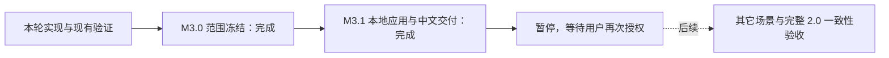

# M3.1 本地应用交付记录

日期：2026-10-27。交付版本：**2.0.0-preview.18，Apple Silicon macOS**。

本次按用户要求收口到 M3.1：交付当前可用应用、中文说明和已知限制。下列有限验收已通过；不再自动推进其它场景。原“补完 2.0 其余场景，并做到效果一致性验证”的长期目标保留并暂停，**完整 M3 和 2.0 全部一致性验收尚未完成**。

## 直接使用

打开 [MathArt Lab 2 Preview.app](</Users/hoo/AIStudio/mathartstudio-rea/studio/dist-desktop-v2/MathArt Lab 2 Preview-darwin-arm64/MathArt Lab 2 Preview.app>) 即可，不必先启动 REA 或开发服务器。

使用步骤见 [中文使用说明与已知问题](m3.1-user-guide.zh-CN.md)。已有 1.0 应用仍保留，本次核对的三个关键文件摘要没有变化。这里交付的是本机预览包，不是已完成全部场景验收的 2.0 正式版。

## 本次固定验收清单

收口前已将以下清单固定到本地执行记录，只复用现有有效证据，不扩展为 11 个场景族的全量验收。

| 验收项 | 实际结果与范围 |
| --- | --- |
| 应用启动 | 实际 preview.18 包成功启动，界面加载、代表场景生成完成；测试使用隐藏窗口，不占用用户屏幕。 |
| 代表场景预览 | 包内导入源隐式场景，生成 90,120 顶点并通过实际原生绘制。GPU 材质使用 CPU 网格计算，不能称为 GPU 网格计算加速。 |
| 参数编辑 | 同一生产代码的公共 App 流程中，编辑参数、点击“应用场景”、等待新状态后录制通过。编辑草稿不等于已经应用。 |
| 保存重开 | 实际包的自动保存及重新启动恢复通过；两阶段正常退出，相关端口关闭，自有后台进程清理完成。 |
| PNG | 实际包完成 500×600 PNG 编码和下载，输出摘要与实际编码输入一致。另有公共 App 的暂停截图、重复截图及缩放截图验证。 |
| 短视频 | 同一生产代码的公共 App CPU/GPU 工作流完成短视频导出，6 段共 33 个解码帧与独立同参数 FFmpeg 编码参考一致。另一个取消后重试视频的 20 帧只验元数据。此项没有宣称在最终 Electron 包里重新逐项录制，也不是原版 MP4 对照。 |
| 说明与交接 | 提供中文操作说明、已知限制和可读验收记录；当前改动以本地 Git 保存，其余任务延期。 |

实际 App 成功范围为跨报告的 CPU 四项与 GPU 四项。CPU 首轮报告整体失败：验证脚本编辑后漏点“应用场景”；修正脚本后，参数用例单独重跑成功。失败原件仍保留，没有改写为整轮成功。

完整技术证据和精确限制见 [本轮实现与验收报告](source-implicit-mesh-reuse.zh-CN.md)。报告同时记录 13 个文件、147 项定向测试通过，以及类型检查和打包构建成功。17 帧有限原版对照的数学层与品牌之前的完整作品层零差异；不能据此推断所有场景、参数或机器都一致。

## 当前可以期待的改进

同一隐式场景没有参数脏写入时，重复生成可以复用已计算的网格。本机 135³ 输入两次重复请求的网格生成从约 2.04 秒降至 49–68 毫秒；包含绘图、公式及 PNG 的完整请求从约 4.44 秒降至 2.46–2.54 秒。首次计算没有提速，持续参数动画仍需要重建；这是有限测量，不是所有操作的速度承诺。

## 已知限制与延期清单

- 原版 **PREVIEW 粒子模式**仍使用不同的本地采样路径，未达到原版一致性。原版参考数据已保留，产品接入延期。
- 11 个场景族的剩余原版效果差异、特定输入和边界要求仍在原账本中，未标记全部完成。
- 当前包的隐式 PNG 个别输入会按实际视口裁切公式；本次包验收的那张 500×600 图中公式位于目标外。不能把“字形请求成功”当作“公式一定出现在图中”。
- 只有这台 Apple Silicon Mac 的证据；跨设备及 Windows、Linux、Intel Mac 等平台发行未验收。
- 当前为本地 ad hoc 签名预览包，未做 Developer ID 公证发行；后续公开发行另行处理。
- GPU/CPU 和分辨率不同的路径各有验证范围；当前结果不保证任意大网格、任意公式或任意时长录制可用。

历史证据、未完成项和缓存保留。本次未开展缓存批量删除，也不把跨设备条件作为 M3.1 的阻断项。
