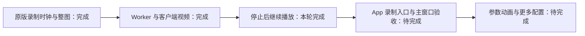

# 隐式曲面录制停止后的连续播放（2026-10-24）

已完成后台运行链路的衔接：停止录制后，继续使用同一个相机和动画队列，以预览墙钟推进；不会按文档 FPS 从头重算。暂停不推进，恢复时重新建立墙钟基准。文档中保存的 FPS 保持不变。

原版三个案例共 **35 个状态的相机、时间、队列完成状态和离屏艺术底图全部匹配，像素差为 0**。本轮尚未连接 App 的 Implicit 录制按钮，因此不代表主窗口操作已验收。



## 改动与原因

原版 `MathArt.stopRecording()` 调用 `Scene.disableRenderMode()`，保留队列和相机，只关闭固定录制步长并重置 `lastTime`。暂停与恢复由 `MathArt.togglePause()` 维护保存的相机角度及墙钟基准。这些调用关系先由固定版本字节码确认，再由原版运行验证。

`SourceImplicitRecordingSession` 现在同时拥有录制及其停止后的延续状态，复用已有 `SourceSceneHostClock`，没有复制一套时间换算。录制时创建的会话标识只能在同一个 Worker 保留的队列上使用。陌生会话、修改后的场景和未经独立控制操作改变的暂停状态会被拒绝。

停止重试会重新生成同一个数值帧的几何缓冲，不重复推进或重置时间基准。录制取消回调不再被队列长期捕获；停止之后的正常播放使用当前请求的取消状态。实时更新后若几何交付失败，该继续播放会话失效，不能悄悄跳过未知更新再接着播放。

客户端验证继续播放身份、观察 FPS、暂停状态、数值帧和视口。Worker 保存实际完成请求的对象身份，暂停控制和再次录制使用该身份。`GenerationQueue` 保留作者文档对象、接受停止期间延后的视口调整，并从输出数值帧反馈时间。对于修改后的 Implicit 文档，不采用其它场景的元数据缓存重绑定捷径。

普通 Implicit 预览仍走原有路径。只有录制停止返回的 `implicitLive` 上下文激活延续状态；恢复普通预览会释放它。App 后续需要在停止回调中接收该上下文，并在编辑、跳转时间、替换场景时明确结束延续状态。

## 实际验证

| 验证项 | 结果 |
| --- | --- |
| 提前停止 | 2 次录制更新后停止，再播放、暂停、静态重绘、恢复：11 个状态匹配 |
| 队列自然完成后停止 | 5 次录制更新及后续操作：14 个状态匹配 |
| 空队列 | 一次预热及后续操作：10 个状态匹配 |
| 特殊墙钟步长 | 正步长、零步长、负步长，均与原版 Float32 状态匹配 |
| 完整离屏艺术底图 | 35 帧、每帧 384×288 RGBA，全部零像素差 |
| 视频回归 | 原有 19 帧底图零差异；三个 128×96 MP4 分别为 4、4、7 帧，均为 1 秒，解码通过；空队列不创建视频 |
| 自动化测试 | 8 个文件、105 项通过；补充时钟排他检查后，最终 24 项复验通过，共覆盖 106 个不同用例 |
| 构建 | 最终 `build:v2` 通过，包含 TypeScript 检查；保留已有大 bundle 提示 |

原版运行使用已授权的本地 MathArt 1.7.8 JAR，SHA-256 为 `a6e1da3acfc05c347d2529c1d590657e2dd798e16d38c55df3dc61312be24018`。诊断宿主只注入可重复的 `millis()`，并关闭宿主调度器的自动 loop/noLoop；场景、`stopRecording`、`togglePause`、绘图、授权判断和水印仍由原版执行。初始化状态被设为已完成场景初始化，以便调用原版暂停分支。

参考绘图持续使用同一个离屏缓冲。本地公开客户端产生主视口数值帧后，比较程序只在单独的绘图副本中选择相同离屏投影。因此，这证明相同投影下的整图一致性，**不证明主窗口截图一致性**。暂停与恢复操作本身不生成新数值帧；诊断宿主在这些边界调用原版 `render` 取得静态画面。

三个原版进程均正常退出、被回收，进程组消失；所有窗口检查都为 0。已有授权与用户设置文件摘要没有改变；原版启动的策略缓存刷新仍是正常副作用。浏览器为 headless，本轮没有移动或聚焦用户窗口。

## 复验记录

本地证据在 `.cache/source-implicit-recording-continuation-20261024/`：

- `reference/`：原版探针、输入、编译命令、运行身份、35 帧数值事实和原始 RGBA。
- `client-native-final/report.json`：实际浏览器、公开 Generator、真实 Worker 和原生绘图的逐帧结果及源码摘要。
- `tests-final.log`：105 项测试；`tests-queue-final.log`：队列调整后 25 项复验；`tests-complete.log`：额外时钟排他检查后的最终复验。
- `video-regression/report.json`：19 帧与 MP4 编码、解码回归。
- `build-complete.log`：最终构建。首次构建发现测试中跨类型断言不正确，已改用生产边界解析函数。

可用已有原生后端复验，输出目录必须尚不存在：

```sh
MATHART_SOURCE_RENDERER_BACKEND="$PWD/.cache/source-native-capture-20261023/backend.json" \
node scripts/verify-source-implicit-continuation.mjs \
  .cache/source-implicit-recording-continuation-20261024/reference \
  .cache/source-implicit-recording-continuation-20261024/recheck
```

35 帧复验耗时 24.733 秒，采样进程族 CPU 42.170 秒、峰值 RSS 2459 MiB；无采样或清理错误，服务遗留进程为 0，运行期间源码摘要稳定。首次运行耗时 24.601 秒。没有控制冷暖缓存，不能据此比较性能；采样可能漏掉短命进程，并未覆盖全部启动和清理。原版三次取样合计约 22.118 秒，其 CPU/RSS、GPU 成本及 agent token 未单独测量。

视频回归耗时 21.656 秒，采样 CPU 37.050 秒、峰值 RSS 2285 MiB；无遗留服务进程。上述采样限制同样适用。

## 尚未完成

下一步连接 App 录制入口和停止回调，在主画布验证自然完成、提前停止、取消重试、暂停恢复和编辑后的会话切换。原版隐式参数动画、带公式录制、更多显示配置及其他场景族仍未完成；本轮也没有进行最终 Apple Silicon 发行。整个 2.0 Goal 保持进行中。
